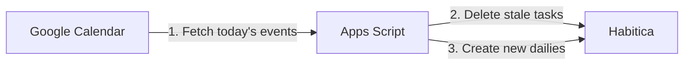

<p align="center">
  
</p>

<h1 align="center">Habitica Google Calendar Sync</h1>

<p align="center">
  <strong>Turn today's Google Calendar events into Habitica dailies — automatically.</strong>
</p>

<p align="center">
  <a href="https://developers.google.com/apps-script">
    
  </a>
  <a href="https://habitica.com/apidoc/">
    
  </a>
  <a href="https://github.com/davicedraz/habitica-google-calendar/blob/main/LICENSE">
    
  </a>
  <a href="https://github.com/davicedraz/habitica-google-calendar/stargazers">
    
  </a>
  <a href="https://github.com/davicedraz/habitica-google-calendar/issues">
    
  </a>
  <a href="https://github.com/davicedraz/habitica-google-calendar/pulls">
    
  </a>
</p>

---

## Table of Contents

- [Why This Exists](#why-this-exists)
- [Features](#features)
- [How It Works](#how-it-works)
- [Quick Start](#quick-start)
- [Configuration](#configuration)
- [Customizing Notes](#customizing-notes)
- [Troubleshooting](#troubleshooting)
- [FAQ](#faq)
- [Contributing](#contributing)
- [Security](#security)
- [License](#license)

## Why This Exists

[Habitica](https://habitica.com) is a habit-building RPG that rewards you for completing tasks. But manually creating dailies for every calendar event is tedious and error-prone.

This lightweight Apps Script bridges the gap — it reads your Google Calendar and automatically creates (and cleans up) matching Habitica dailies, so your schedule and your in-game quest stay perfectly aligned.

**Zero servers. Zero costs. Just a single script file.**

## Features

- **Automatic sync** — Creates a Habitica daily for each event on today's calendar
- **Smart deduplication** — Skips events that already exist as tasks
- **Preserves progress** — Never deletes or recreates completed dailies
- **Self-cleaning** — Removes calendar tasks that are no longer on today's schedule
- **Custom notes** — Attach locations and images to tasks using Markdown
- **Serverless** — Runs entirely inside Google Apps Script (no hosting needed)

## How It Works



Each time the script runs it performs four steps:

1. **Fetch** today's events from your chosen Google Calendar.
2. **Fetch** your current Habitica dailies that were created by this script (identified by the `:calendar:` prefix).
3. **Delete** any script-created tasks that are incomplete and no longer on today's calendar.
4. **Create** a new daily for each unique event title that doesn't already exist.

Completed dailies are always left untouched, so you never lose progress.

## Quick Start

### 1. Create an Apps Script project

Go to [script.google.com](https://script.google.com) and click **New project**.

### 2. Paste the code

Copy the entire contents of [`index.gs`](index.gs) and paste it into the editor (replacing the default `Code.gs` content).

### 3. Set your credentials

Open **Project Settings** (gear icon) > **Script Properties** and add three entries:

| Property         | Where to find it                                                                 |
| ---------------- | -------------------------------------------------------------------------------- |
| `CALENDAR_NAME`  | The exact name of the Google Calendar you want to sync (e.g. `Work`, `Personal`) |
| `HABITICA_ID`    | Habitica > Settings > [API](https://habitica.com/user/settings/api) > User ID    |
| `HABITICA_TOKEN` | Habitica > Settings > [API](https://habitica.com/user/settings/api) > API Token  |

### 4. Authorize and run

Select `syncToHabitica` from the function dropdown and click **Run**. Google will ask you to authorize calendar access — accept the permissions.

### 5. Set up a trigger

Go to **Triggers** (clock icon on the left) > **Add Trigger**:

- **Function**: `syncToHabitica`
- **Event source**: Time-driven
- **Type**: Hour timer or Day timer (your choice)

That's it! Your calendar events will now appear as Habitica dailies automatically.

## Configuration

| Property         | Required | Description                                    |
| ---------------- | -------- | ---------------------------------------------- |
| `CALENDAR_NAME`  | Yes      | Name of the Google Calendar to read events from |
| `HABITICA_ID`    | Yes      | Your Habitica User ID                          |
| `HABITICA_TOKEN` | Yes      | Your Habitica API Token                        |

> **Tip:** You can find your Habitica API credentials at [habitica.com/user/settings/api](https://habitica.com/user/settings/api).

## Customizing Notes

Edit the `createTaskNote(title, location)` function in `index.gs` to attach custom notes or images to specific tasks. The function receives the event title and location, and returns a Markdown string used as the task's notes field.

**Example — add a gym image when the event title contains "Gym":**

```javascript
function createTaskNote(title, location) {
  if (title.includes("Gym")) {
    return (location || "") + "\n\n";
  }
  return location || "";
}
```

## Troubleshooting

| Problem                     | Solution                                                                                                  |
| --------------------------- | --------------------------------------------------------------------------------------------------------- |
| `Calendar not found`        | Verify that `CALENDAR_NAME` matches the calendar name exactly (case-sensitive). Make sure you have access. |
| `401 Unauthorized`          | Double-check `HABITICA_ID` and `HABITICA_TOKEN` in Script Properties.                                     |
| Tasks not appearing         | Run the script manually once to grant authorization. Check that the trigger is enabled.                    |
| `Missing Script Properties` | Open Project Settings > Script Properties and add the three required properties.                           |
| Duplicate tasks             | Make sure you don't have multiple triggers calling `syncToHabitica` simultaneously.                        |

## FAQ

<details>
<summary><strong>Can I sync multiple calendars?</strong></summary>

Not out of the box. The script reads from a single calendar defined by `CALENDAR_NAME`. To sync multiple calendars, you can duplicate the sync logic for each calendar name or modify the script to iterate over an array of calendar names.
</details>

<details>
<summary><strong>Will it delete tasks I created manually in Habitica?</strong></summary>

No. The script only manages tasks that have the `:calendar:` emoji prefix. Any tasks you create manually in Habitica are completely untouched.
</details>

<details>
<summary><strong>How often should the trigger run?</strong></summary>

An hourly trigger works well for most people. If your calendar changes frequently throughout the day, you can set it to run every 15 or 30 minutes. A daily trigger is fine if your schedule is set the night before.
</details>

<details>
<summary><strong>Does it work with shared/subscribed calendars?</strong></summary>

Yes, as long as the calendar is visible in your Google Calendar and you use the exact calendar name in `CALENDAR_NAME`.
</details>

<details>
<summary><strong>Is there an API rate limit?</strong></summary>

Habitica's API has a rate limit of 30 requests per minute. The script makes one request per event plus a few overhead requests, so this is only a concern if you have 25+ events in a single day.
</details>

## Contributing

Contributions, issues, and feature requests are welcome! Check the [issues page](https://github.com/davicedraz/habitica-google-calendar/issues) to get started.

Please read [`CONTRIBUTING.md`](CONTRIBUTING.md) for guidelines.

## Security

Never share your Habitica API tokens publicly. If you discover a security vulnerability, please see [`SECURITY.md`](SECURITY.md) for responsible disclosure instructions.

## License

[MIT](LICENSE) &copy; [Davi Cedraz](https://github.com/davicedraz)

---

<p align="center">
  If this project helps you stay productive, consider giving it a <a href="https://github.com/davicedraz/habitica-google-calendar">star</a>!
</p>
